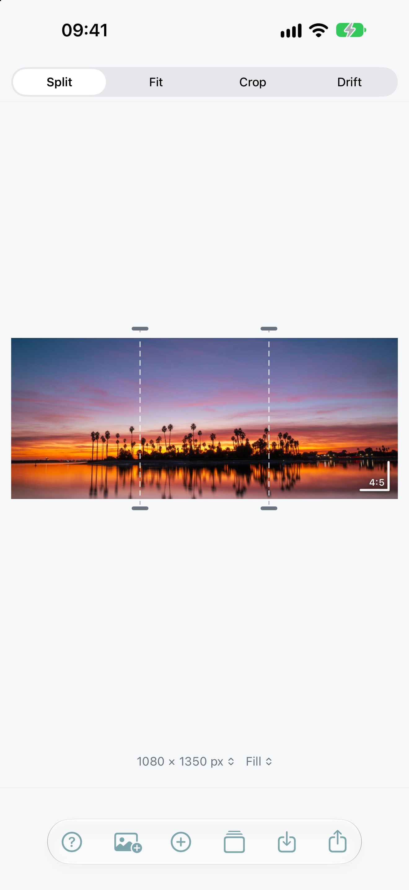
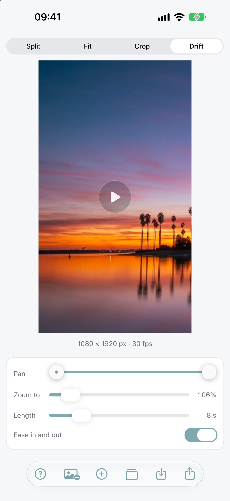
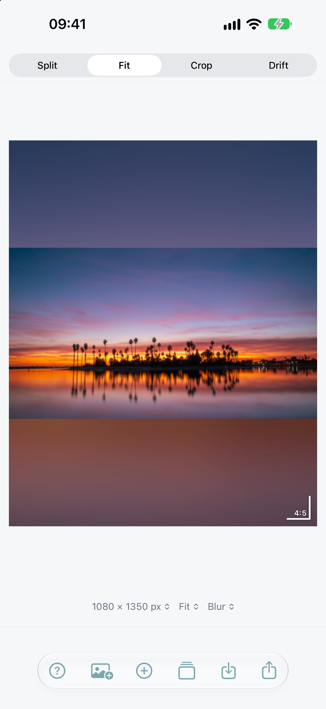
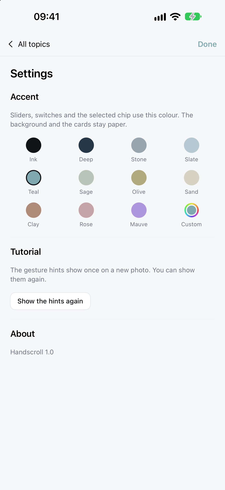

# Handscroll

**One wide photo, a few good ways to post it.**

Handscroll is a small iOS app that turns one wide photo into slides, a tall crop, or a short pan video — entirely on your iPhone. No account, no analytics, no network access.

<p>
  
  
  
  
</p>

## What it does

- **Split** — cut one wide photo into 2–5 slides that line up exactly across a post.
- **Fit** — put the whole photo inside a tall 4:5 frame, with the empty space filled by a blur, a solid colour, black or white.
- **Crop** — a tall crop with the composition you choose.
- **Drift** — a slow pan across the photo, exported as an 8-second MP4.
- **Batch** — apply the same steps to up to 10 photos and export them all at once.
- **Help** — a built-in manual (Basics, Split, Fit, Crop, Drift, Batch, Settings) that explains every control.
- **Palette** — 11 hand-tuned accent colours (Pantone-calibrated), plus a custom colour.
- A 4:5 warning when a frame is taller than most apps and scheduling tools will accept.

## Privacy

Everything is processed on device. There is no account, no sign-in, no analytics, no advertising, no third-party SDKs, and no network access. Photos are reached only through the system picker; finished files are written to your photo library or shared by you. See the [privacy policy](https://weiniverse.com/handscroll/privacy/) and [support](https://weiniverse.com/handscroll/support/).

## Requirements

- iOS 17.0 or later, iPhone
- Xcode 26 or later (this project is built with Xcode 27.2)
- [XcodeGen](https://github.com/yonaskolb/XcodeGen) 2.46+ — the Xcode project is generated from `project.yml`

## Build and run

```sh
brew install xcodegen     # once
git clone https://github.com/weirui828/handscroll.git
cd handscroll
xcodegen generate
open Seamless.xcodeproj
```

Then pick the `Seamless` scheme and an iPhone simulator (or your device) and run. `Seamless.xcodeproj` is generated and intentionally not tracked — run `xcodegen generate` again after adding, removing, or moving files under `Seamless/`.

To sign for a device, select your team in **Signing & Capabilities** (the project uses automatic signing; no team is checked in).

## Demo launch arguments

The app ships a bundled demo photo and a set of launch arguments so screenshots and UI states can be reproduced without tapping. They are compiled into Debug builds only and live in `ContentView.swift`.

In Xcode: **Product › Scheme › Edit Scheme › Run › Arguments**, or pass them directly with `simctl`:

```sh
xcrun simctl launch booted com.weiniverse.handscroll \
  -demoPhoto -demoClean -demoMode Split -demoSlides 3
```

| Argument | Effect |
| --- | --- |
| `-demoPhoto` | load the bundled `demo.jpg` instead of the photo picker |
| `-demoMode <Split\|Fit\|Crop\|Drift>` | start in that mode |
| `-demoSlides <2–5>` | set the number of slides |
| `-demoShape <Auto\|4:5\|3:4\|1:1>` | set the frame shape |
| `-demoPlay` | start the Drift preview playing |
| `-demoBatch` | open the Batch screen |
| `-demoHelp`, `-demoBasics`, `-demoTopic <topic>` | open the manual |
| `-demoSettings` | open Help › Settings |
| `-demoColor` | switch the accent to the demo colour |
| `-demoWarning` | show the 4:5 warning |
| `-demoClean` | hide the one-time gesture hints |
| `-demoSave`, `-demoDismiss` | exercise the save flow without a tap |

The store screenshots in [`appstore/screenshots/`](appstore/screenshots) were captured with these arguments on an iPhone 18 Pro Max simulator (1320 × 2868).

## Project layout

| Path | What it is |
| --- | --- |
| `project.yml` | XcodeGen spec — target settings, bundle id, Info.plist keys |
| `Seamless/` | SwiftUI sources and the asset catalog |
| `Seamless/EditorModel.swift` | editor state: layout, photo, drift, export steps |
| `Seamless/Geometry.swift` | `Mode`, `Shape`, and the frame maths behind Split/Fit/Crop |
| `Seamless/Renderer.swift`, `DriftEncoder.swift`, `Exporter.swift` | drawing, MP4 encoding, file output |
| `Seamless/HelpView.swift` | the in-app manual |
| `docs/` | the GitHub Pages site (privacy policy and support) |
| `appstore/` | App Store screenshots and the submission checklist |

## Contributing

Issues and pull requests are welcome at [github.com/weirui828/handscroll/issues](https://github.com/weirui828/handscroll/issues). Please keep the app offline and account-free — that is the point of the product.

## License

[MIT](LICENSE) © 2026 Wei Rui
